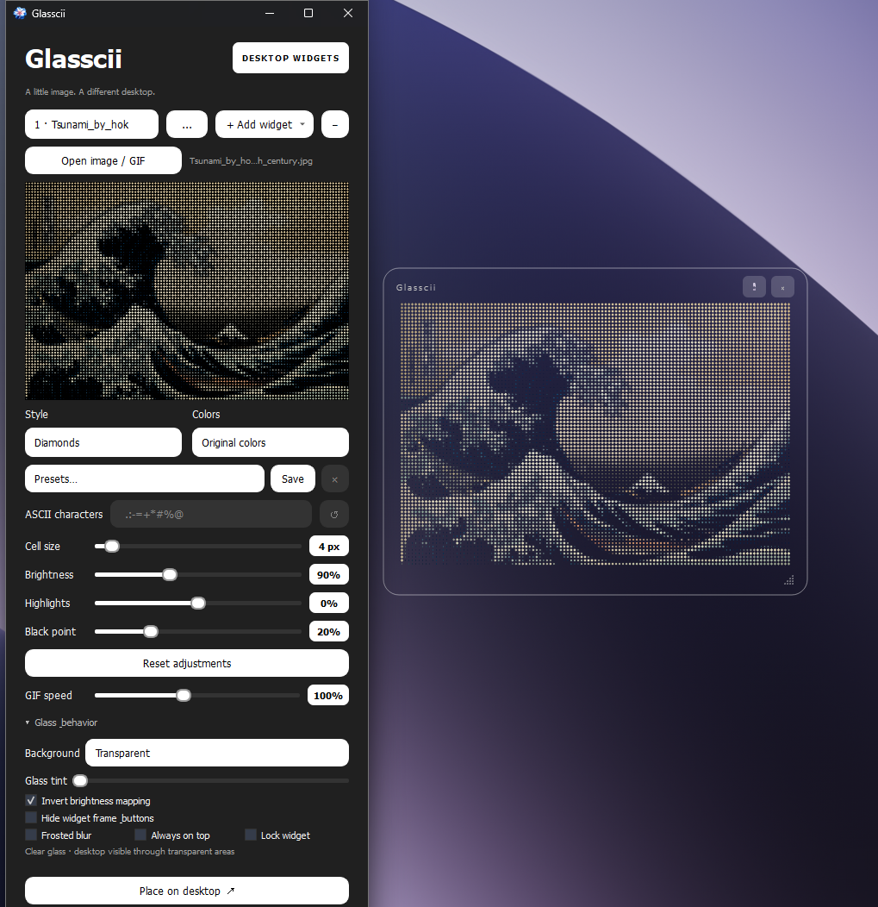

<p align="center"></p>
<h1 align="center">Glasscii</h1>
<p align="center">Turn images and GIFs into interactive art on your Windows desktop.</p>

[العربية](README_AR.md)

Glasscii converts an image or animated GIF into ASCII, Halftone, Diamonds, or Voxels and displays it as a customizable desktop widget. Adjust the result in the editor, then place it on your desktop. No export step is required.

## Features

- Four rendering styles: ASCII, Halftone, Diamonds, and Voxels.
- Original image colors or grayscale.
- Custom ASCII characters, cell size, brightness, highlights, black point, and invert controls.
- Animated GIF playback with adjustable speed.
- Transparent widgets with optional glass effects, tint, and a hidden-frame mode.
- Multiple independent image and clock widgets, with names and saved positions.
- Clock and date widgets with customizable fonts, sizes, colors, and time formats.
- Presets for reusing image and clock appearances.
- Mouse interaction with the artwork and editor surface.

  

## Run on Windows

**Using the executable:** download `Glasscii.exe`.

**Using the source:** install Python 3.11 or newer, open PowerShell in the project folder, and run:

```powershell
py -3 -m venv .venv
.\.venv\Scripts\python.exe -m pip install -r requirements.txt
.\.venv\Scripts\python.exe app.py
```

Activation is optional because these commands use the environment's Python directly. `ui.py`, `engine.py`, and the other project modules are local source files, not packages to install separately.

## Usage

1. Open an image or GIF with the file picker, or drag it into the editor.
2. Choose a style, colors, and cell size. Smaller cells provide more detail and require more rendering work.
3. Adjust the tone controls; enter your own characters for ASCII mode.
4. Show the desktop widget, then move or resize it. Lock it to prevent dragging.
5. Add another image or clock widget using the widget controls or tray menu.



Hiding a widget's frame also hides its buttons. Right-click the widget for **Settings** or **Show frame**, or use the tray icon beside the Windows clock. To exit completely, select **Quit** in the tray menu.

Settings, widget layouts, and presets are stored locally using Qt's `QSettings`. Restoring an image widget requires its original image file to remain available. A GIF pauses when both its editor and desktop widget are hidden or minimized.

## Build the Windows executable

Build on Windows using the same environment that runs the app:

```powershell
.\.venv\Scripts\python.exe -m pip install "PyInstaller>=6,<7"
.\.venv\Scripts\python.exe -m PyInstaller --noconfirm --clean --onefile --windowed --name Glasscii --icon icon.ico --add-data "icon.ico:." app.py
```

The result is `dist/Glasscii.exe`. The icon is included both as the executable icon and as a runtime resource for the window and tray. Rebuild after changing the source. `build/`, `dist/`, and `.venv/` do not belong in the source repository.

## Development and tests

```powershell
.\.venv\Scripts\python.exe -m unittest discover -s tests -v
```

The tests use Qt's offscreen platform and temporary settings. They cover frame/layout stability and independent selection from the tray's widget menu. They do not replace testing native Windows transparency, taskbar behavior, or the packaged executable on Windows.

| File | Purpose |
| --- | --- |
| `app.py` | Image controller, desktop window, GIF scheduling, application startup |
| `engine.py` | Decode images/GIFs, sample pixels, enforce resource limits |
| `renderer.py` | Draw ASCII and shape styles into image frames |
| `interaction.py` | Artwork display and mouse displacement effect |
| `ui.py`, `ui_motion.py` | Editor styling, sliders, popup animations, mouse glow |
| `workspace.py` | Manage multiple widgets and tray navigation |
| `clock_widget.py` | Clock/date configuration and rendering |
| `presets.py` | Capture, save, and apply appearance presets |
| `windows_effects.py` | Native Windows glass integration |


